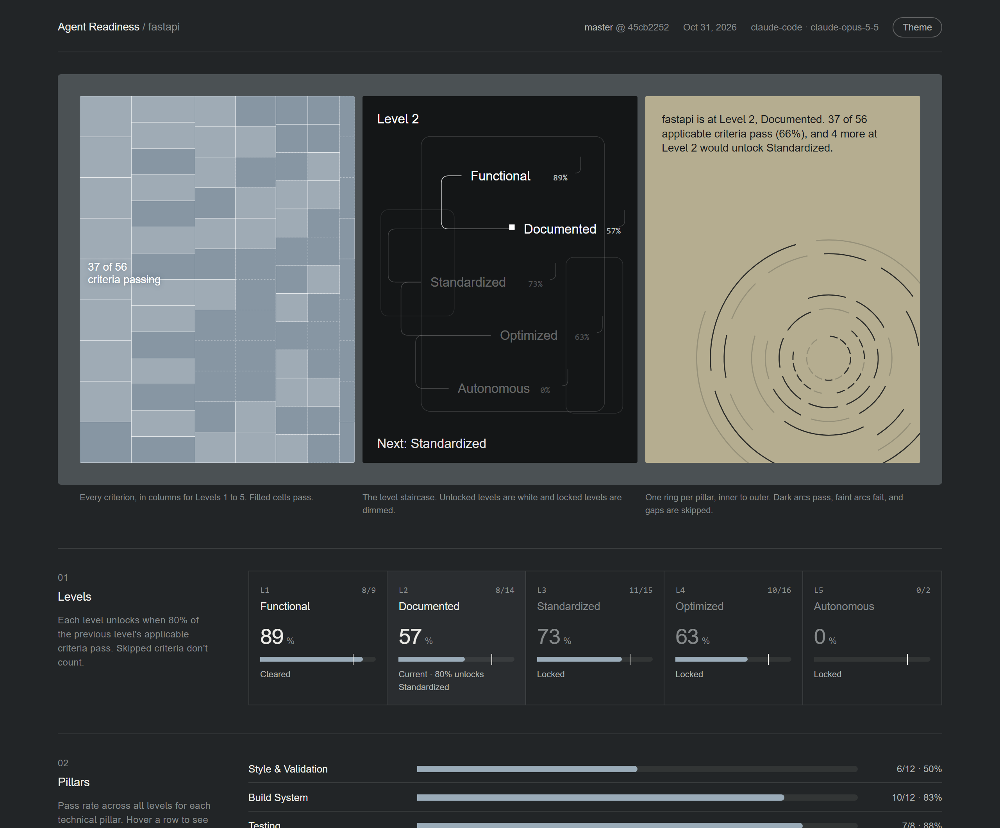

# agent-readiness

**Is your repo ready for coding agents?** This is an open [Agent Skill](https://agentskills.io) that scores a repository on five levels of agent readiness and renders a dashboard of the results. It works in any harness that loads `SKILL.md` skills: Claude Code, Codex, Cursor, Gemini CLI, GitHub Copilot, Factory Droid, OpenCode and others.



When agents underperform, the cause is usually the codebase rather than the model. Without hooks, an agent waits ten minutes for CI to report a lint error it could have caught in a second. Undocumented environment variables leave it guessing. Builds that rely on tribal knowledge leave it no way to verify its own work. This skill measures those gaps and ranks what to fix first.

## What it measures

80+ criteria across **9 pillars**, gated into **5 levels**:

| Level | Name | What it means | Example criteria |
|---|---|---|---|
| 1 | Functional | Code runs and basic tooling exists | README, linter, type checker, lockfile, unit tests |
| 2 | Documented | Workflows are written down; local guardrails exist | AGENTS.md, pre-commit hooks, env template, devcontainer, branch protection |
| 3 | Standardized | Processes are enforced by automation | integration tests, secret scanning, structured logging, tracing, coverage |
| 4 | Optimized | Feedback is fast and measured | CI under 10 minutes, flaky-test detection, release cadence, alerting |
| 5 | Autonomous | The system checks and improves itself | verified agent instructions, progressive rollout, errors that become tasks |

A level unlocks when **80%** of the previous level's applicable criteria pass. Pillars: Style & Validation, Build System, Testing, Documentation, Dev Environment, Debugging & Observability, Security & Governance, Task Discovery, Product & Experimentation. The full list with pass rules is in [docs/criteria.md](docs/criteria.md).

## How it works

```
scan.py ──► draft.json ──► your agent decides ──► decisions.json ──► report.py ──► report.html
(files, configs,         (~80 provisional      (judgment calls,                 summary.md
 git history, gh)         verdicts)             spot-checks, rationale)         history.jsonl
```

1. **A deterministic scan** collects evidence: config files, dependencies, CI workflows, git history, and the platform CLI (`gh`) for branch protection, CI timing, labels and issues. It returns a provisional verdict for every criterion and marks the judgment calls as `review`.
2. **Your agent** resolves the `review` items, checks the scanner's other verdicts against the actual files, and writes a one-line rationale for each decision.
3. **A script does the scoring.** The model never does arithmetic. Each run is grounded on the previous report, so verdicts only change when the evidence does, which keeps scores comparable over time.

The scripts are standard-library Python 3.8+ with nothing to install. The dashboard is a single HTML file that works offline.

## Install

With the [`skills` CLI](https://github.com/vercel-labs/skills), which detects your installed agents:

```bash
npx skills add Luminary-AI-Solutions/agent-readiness
```

Or copy the two folders in `skills/` into your harness's skills directory. Common locations (check your tool's docs; these change):

| Harness | Project | User-wide |
|---|---|---|
| Claude Code | `.claude/skills/` | `~/.claude/skills/` |
| OpenAI Codex | `.agents/skills/` | `~/.codex/skills/` |
| Factory Droid | `.factory/skills/` | `~/.factory/skills/` |
| Cursor | `.cursor/skills/` | `~/.cursor/skills/` |
| Gemini CLI | `.gemini/skills/` | `~/.gemini/skills/` |
| GitHub Copilot | `.github/skills/` | `~/.copilot/skills/` |

No skill support? Tell your agent: *"Follow the instructions in `skills/agent-readiness/SKILL.md` to evaluate this repo."*

## Use

Ask in plain language:

- *"Run an agent readiness report on this repo."*
- *"How agent-ready is this codebase? What should we fix first?"*
- *"Fix the readiness gaps."* (uses `agent-readiness-fix`)

Output lands in `.agent-readiness/`:

| File | What it is |
|---|---|
| `report.html` | The dashboard: level staircase, criteria grid, pillar rings, next steps, trend, and a filterable list of every criterion with its evidence |
| `summary.md` | The same results as markdown, ready for a PR, issue or chat |
| `report.json` | Every verdict and rationale. Commit it so the next run stays consistent. |
| `history.jsonl` | One line per run. Commit it to get a trend chart. |

### Without an agent (CI, quick look)

The scanner works alone. Skipping the judgment step gives a provisional, heuristic-only score, which is useful for tracking a trend in CI:

```bash
python skills/agent-readiness/scripts/scan.py . && python skills/agent-readiness/scripts/report.py .agent-readiness/draft.json --allow-review
```

## Example

[`examples/fastapi/`](examples/fastapi/) is a full report on [fastapi/fastapi](https://github.com/fastapi/fastapi), produced by an agent that followed `SKILL.md` cold. It includes the dashboard, the summary, every rationale, and the agent's `decisions.json`.

FastAPI comes out at **Level 2 (Documented), 66% of applicable criteria passing**. It's strong on testing and build automation. What blocks Level 3 is mostly missing contributor-facing agent scaffolding: no AGENTS.md, no PR template, no CODEOWNERS. Factory's published report puts the same repo at Level 3. Expect differences like that: this model puts agent instructions and repo guardrails at Level 2, so they gate earlier.

## Credits

The five-level model, the 80% gate, the pillar structure and the practice of grounding each evaluation on the previous report come from [Factory's Agent Readiness Model](https://docs.factory.com/agent-readiness/overview) and their [launch write-up](https://factory.com/news/agent-readiness). This is an independent, harness-agnostic implementation. It is not affiliated with or endorsed by Factory, and its criteria, wording and scoring details are its own.

## Contributing

See [AGENTS.md](AGENTS.md). In short: `criteria.json` is the source of truth, scanner checks stay conservative, scoring stays in `report.py`, and `python -m unittest discover -s tests` must pass.

## License

[MIT](LICENSE)
